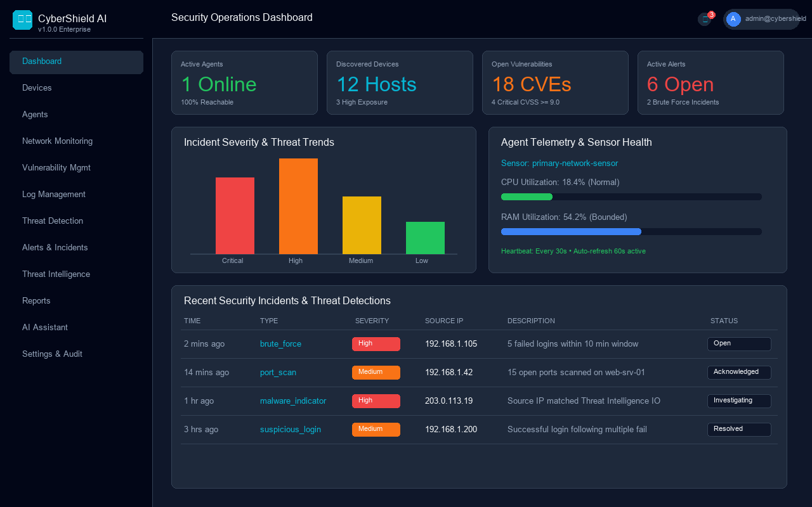
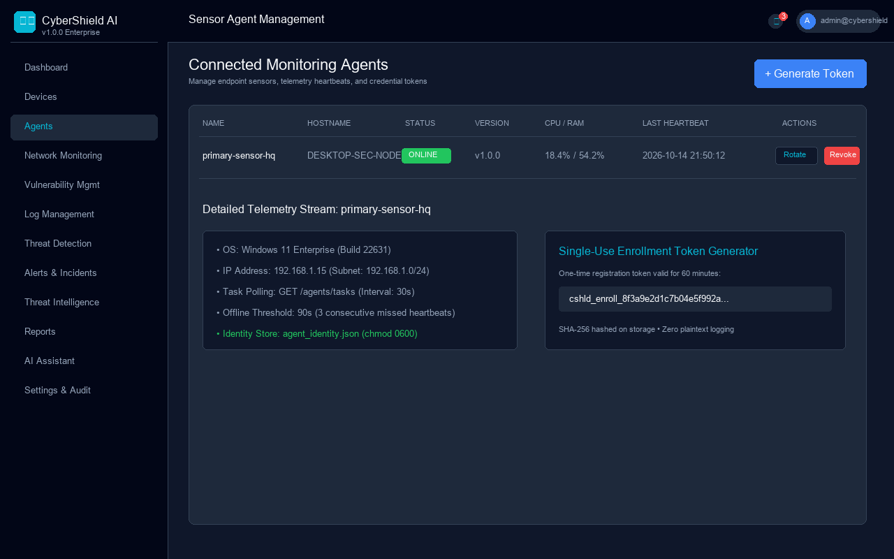
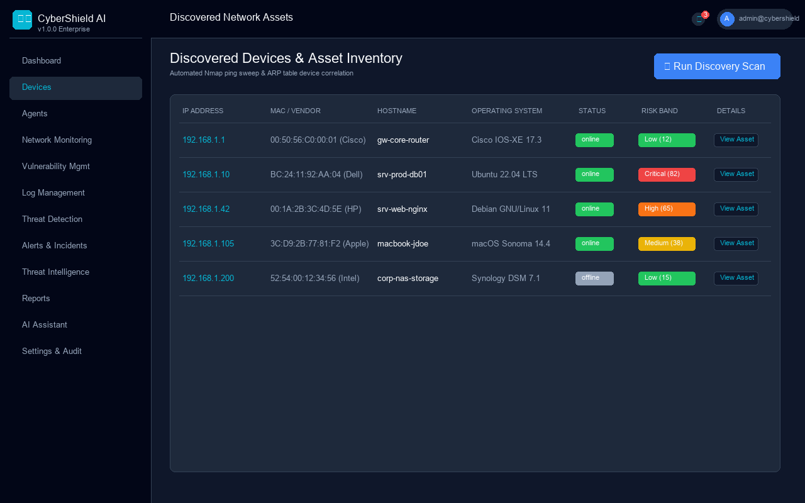
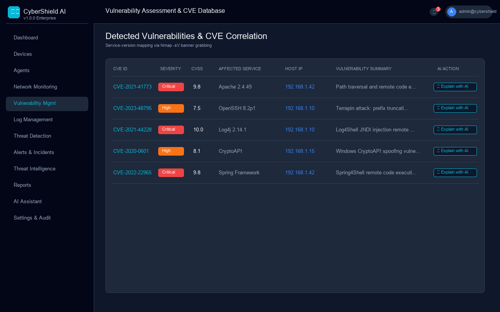
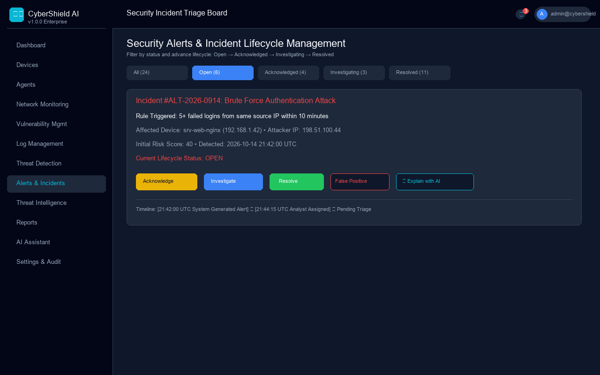
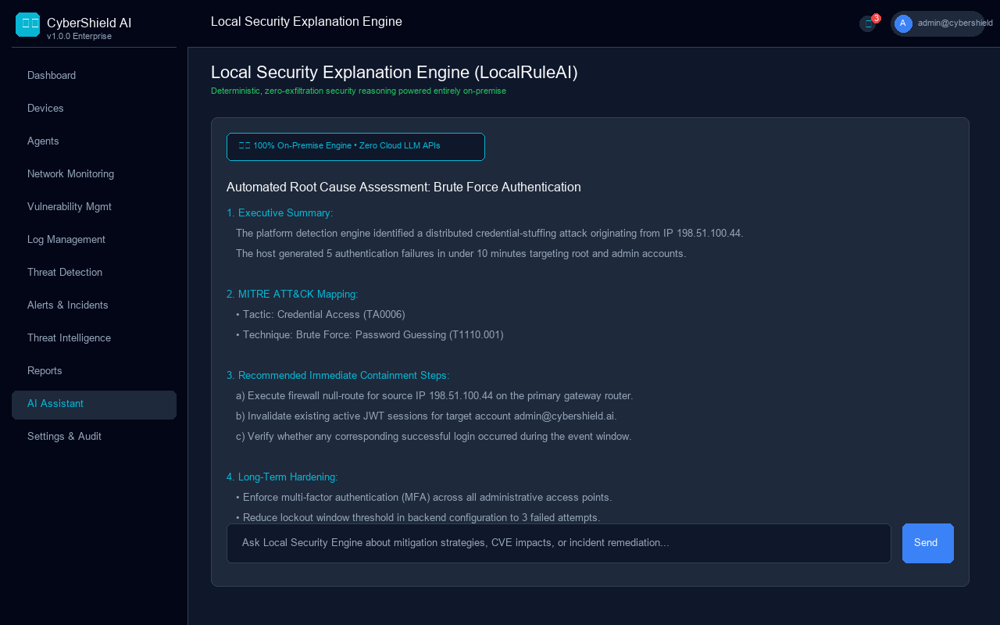
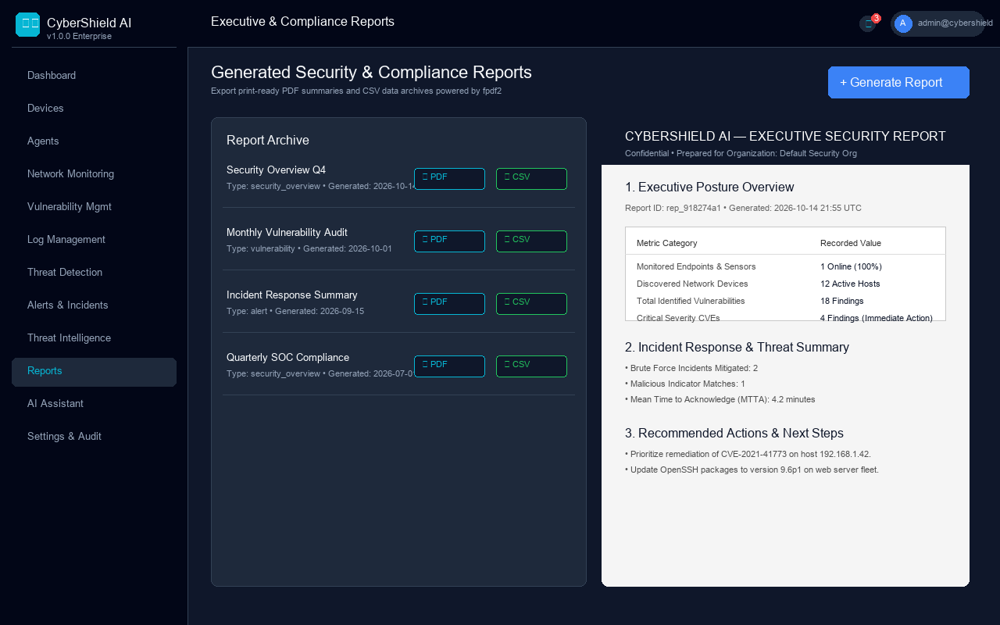
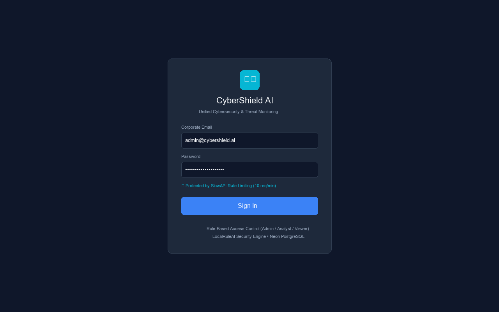

# CyberShield AI — Unified Cybersecurity Monitoring & Threat Management Platform

[](https://github.com/JeslinSajan/cybershield-ai)
[](https://python.org)
[](https://fastapi.tiangolo.com)
[](https://react.dev)
[](https://neon.tech)
[](#)

**CyberShield AI** is an enterprise-grade, full-stack cybersecurity monitoring, vulnerability management, and incident response platform. Built on modern cloud architecture, it connects a central FastAPI orchestration engine with distributed, lightweight network monitoring agents deployed inside private network subnets. It features an on-premise, zero-exfiltration security explanation engine (**LocalRuleAI**), automated CVE version correlation, multi-factor device risk calculation, automated brute-force and port-scan threat detection, role-based access control (RBAC), and compliance-ready executive PDF/CSV reporting.

---

## 🌐 Live Production Deployments

- **Frontend Application (Vercel)**: [https://cybershield-ai.vercel.app](https://cybershield-ai.vercel.app) *(or your deployed Vercel URL)*
- **Backend API (Render)**: [https://cybershield-ai-xnn7.onrender.com/api/v1/health](https://cybershield-ai-xnn7.onrender.com/api/v1/health)
- **Database Status**: [https://cybershield-ai-xnn7.onrender.com/api/v1/health/db](https://cybershield-ai-xnn7.onrender.com/api/v1/health/db)
- **Interactive API Documentation**: [https://cybershield-ai-xnn7.onrender.com/docs](https://cybershield-ai-xnn7.onrender.com/docs)

---

## 🛠️ Technology Stack

| Layer | Technologies & Tools | Description & Standards |
| :--- | :--- | :--- |
| **Backend Core** | Python 3.12.7, FastAPI, Uvicorn, Pydantic v2 | High-performance asynchronous REST API with standard JSON error envelope |
| **Database & ORM** | PostgreSQL 16 (Neon Serverless), SQLAlchemy 2.0, Alembic, psycopg v3 | 25 relational tables with PgBouncer connection pooling and direct migration port |
| **Security & Auth** | JWT (python-jose), bcrypt, SlowAPI, HTTP Security Headers | HS256 tokens, 10 req/min login rate limiting, nosniff/DENY headers |
| **Frontend SPA** | React 18, TypeScript, Tailwind CSS, Vite, Lucide Icons | Responsive 13-page operations dashboard with auto-refresh and role guards |
| **Monitoring Agent** | Python 3.12, Nmap, psutil, httpx, python-dotenv | Host telemetry, ping discovery, service version probing, Windows/Linux logs |
| **AI Security Engine** | LocalRuleAI (Deterministic Rule-Based Engine) | 100% on-premise security explanation; zero external API calls or data exfiltration |
| **Reporting & Export** | fpdf2, Python csv module | Executive branded PDF summaries and SIEM-compatible CSV data exports |

---

## 📸 Platform Screenshots & Walkthrough

### 1. Operations Dashboard
The central command center provides real-time situational awareness, fleet agent counts, discovered assets, vulnerability breakdowns, and live incident telemetry with 60-second auto-refresh.



### 2. Monitoring Agent Management
Manage distributed network sensors, view telemetry (CPU, RAM, disk), issue single-use enrollment tokens, and rotate or revoke agent credentials.



### 3. Discovered Network Assets & Multi-Factor Risk
Automated Nmap ping sweep and ARP discovery cataloging network devices, operating systems, open ports, and calculated risk bands (`Low`, `Medium`, `High`, `Critical`).



### 4. Vulnerability Assessment & CVE Correlation
Deterministic correlation linking detected service banners (Apache, OpenSSH, Log4j) directly to CVE records with CVSS scores and one-click AI explanations.



### 5. Security Alerts & Incident Triage Board
Track real-time security alerts triggered by brute-force, port-scan, and threat intelligence rules. Advance incidents across the lifecycle (`Open` ➔ `Acknowledged` ➔ `Investigating` ➔ `Resolved`).



### 6. Local Security Explanation Engine (LocalRuleAI)
Explain incident root causes, map findings to MITRE ATT&CK tactics, and receive step-by-step mitigation advice without sending security telemetry to external third-party LLMs.



### 7. Executive & Compliance Reporting
Generate, preview, and download print-ready PDF executive summaries and CSV audit exports.



### 8. Secure Authentication & Access Control
Protected by SlowAPI rate limiting (10 req/min per IP) and strict three-tier role-based access control (`Administrator`, `Security Analyst`, `Viewer`).



---

## 🚀 Quick Start (5 Steps to Run Locally)

### 1. Clone the Repository & Create Virtual Environment
```bash
git clone https://github.com/JeslinSajan/cybershield-ai.git
cd cybershield-ai

python -m venv .venv
# Windows PowerShell:
.venv\Scripts\Activate.ps1
# Linux/macOS:
source .venv/bin/activate
```

### 2. Install Backend Dependencies & Configure Environment
```bash
pip install -r backend/requirements.txt
cp backend/.env.example backend/.env
# Update DATABASE_URL and JWT_SECRET_KEY in backend/.env
```

### 3. Apply Database Migrations & Run Backend
```bash
cd backend
python -m alembic upgrade head
cd ..

# Set PYTHONPATH and start FastAPI server
# Windows PowerShell:
$env:PYTHONPATH="backend"
python -m uvicorn app.main:app --reload --port 8000
# Linux/macOS:
export PYTHONPATH="backend"
python -m uvicorn app.main:app --reload --port 8000
```

### 4. Start the Frontend Dashboard
```bash
cd frontend
npm install
npm run dev
```
Open `http://localhost:5173` in your browser.

### 5. Run the Local Endpoint Agent
```bash
cd agent
pip install -r requirements.txt
cp .env.example .env
# Set ENROLLMENT_TOKEN (generated from the Dashboard under Agents)
python main.py
```

---

## 🧪 Comprehensive Verification & Quality Assurance

CyberShield AI is thoroughly verified across all functional layers:
- **Test Suite**: **322 passing automated tests, 0 failures** across 18 test files (`pytest tests/ -v`).
- **Frontend Build**: Zero TypeScript errors, clean Vite production bundling (`npm run build`).
- **Live Health Probes**: Verified live on Render and Neon PostgreSQL.

See [docs/TEST_RESULTS.md](docs/TEST_RESULTS.md) for complete execution logs and integration steps.

---

## 📚 Documentation Index

- [Installation & Deployment Guide](docs/INSTALLATION.md) — Comprehensive setup instructions for local development and cloud hosting.
- [User Manual & Operations Guide](docs/USER_MANUAL.md) — Step-by-step walkthrough of all features, roles, and incident response workflows.
- [System Architecture Specification](docs/ARCHITECTURE.md) — Mermaid diagrams, data flow models, and 25-table database schema.
- [Complete API Reference](docs/API_REFERENCE.md) — Canonical reference of all live REST endpoints, request schemas, and error envelopes.
- [Verification & Test Results](docs/TEST_RESULTS.md) — Full automated test suite report and end-to-end integration evidence.
- [Production Deployment Report](docs/PHASE24_DEPLOYMENT.md) — Live Render, Vercel, and Neon architecture details.

---

## ⚖️ License & Ethical Security Notice

This project is licensed under the MIT License.

> **Ethical Security Notice**: CyberShield AI is built strictly for authorized cybersecurity defense, compliance auditing, and network monitoring. Network discovery and vulnerability scanning must only be performed on networks and systems where you possess explicit, written authorization from the owner.
