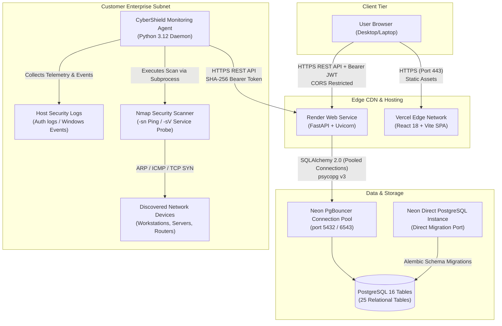

# CyberShield AI — System Architecture & Design Specification

CyberShield AI is an enterprise-grade cybersecurity monitoring, threat management, and incident response platform. This document specifies the production architecture, communication topologies, software modules, and data persistence layers.

---

## 1. High-Level System Architecture

CyberShield AI separates network monitoring execution from central orchestration:
- **Local Endpoint Agent**: Deployed inside the target private network; executes authorized scanning, collects system telemetry, and captures host logs.
- **Central Backend API**: FastAPI asynchronous web application running on Render; handles RBAC authentication, detection rule processing, risk calculation, and compliance reporting.
- **Serverless PostgreSQL Database**: Hosted on Neon PostgreSQL with PgBouncer connection pooling and direct migration channels.
- **Frontend SPA**: React 18 single-page application hosted on Vercel Edge Network.



---

## 2. Core Architectural Principles & Security Design

1. **Zero External AI Exfiltration (`LocalRuleAI`)**:
   - The security explanation engine runs 100% locally on the backend.
   - No customer security data, IP addresses, or CVE details are ever transmitted to third-party LLMs or cloud providers.
2. **Strict Multi-Tenant Isolation**:
   - Every table contains an `organization_id` column.
   - All queries filter strictly by the authenticated user's or agent's tenant organization, preventing cross-tenant leakage.
3. **Dual-Tier Authentication**:
   - **Users**: Authenticated via email/password using `bcrypt` password hashing, receiving signed HS256 JWT tokens.
   - **Agents**: Authenticated using dedicated SHA-256 hashed bearer tokens issued through single-use administrator enrollment tokens.
4. **Security Hardening**:
   - **Rate Limiting**: `POST /auth/login` is rate-limited to 10 req/min per IP via `SlowAPI`.
   - **Security Headers**: All API responses enforce `X-Content-Type-Options: nosniff`, `X-Frame-Options: DENY`, and `Referrer-Policy: strict-origin-when-cross-origin`.
   - **Production Error Sanitization**: Internal tracebacks and SQL errors are suppressed (`details: []`).

---

## 3. Backend Module Structure (`backend/app/`)

```
backend/app/
├── api/
│   └── v1/
│       ├── agents.py               # Agent enrollment, heartbeat, task polling, revocation
│       ├── ai.py                   # LocalRuleAI alert, vuln, risk explanation & chat
│       ├── alerts.py               # Incident alert CRUD, lifecycle transitions, history
│       ├── audit_logs.py           # Compliance audit trail listing & filtering
│       ├── auth.py                 # User authentication, login rate limiting, session
│       ├── dashboard.py            # Aggregated metrics, agent counts, recent alerts
│       ├── devices.py              # Discovered device inventory & device-specific risk
│       ├── health.py               # System & Neon database health probes
│       ├── logs.py                 # Centralized security log ingestion & queries
│       ├── network_monitoring.py   # Interface & network metric snapshots
│       ├── notifications.py        # Real-time alert notifications & read markers
│       ├── reports.py              # PDF/CSV generation, archiving, and streaming download
│       ├── scans.py                # Network scan creation, tracking, and results
│       ├── settings.py             # Tenant configuration key-value storage
│       ├── threat_intelligence.py  # Threat indicator CRUD & IOC matching
│       ├── users.py                # User administration and RBAC management
│       └── vulnerabilities.py      # CVE correlation & vulnerability findings
├── core/
│   ├── config.py                   # Pydantic v2 settings & environment variables
│   ├── database.py                 # SQLAlchemy 2.0 engine, pooler keepalives, get_db
│   ├── deps.py                     # RBAC dependency guards (Admin, Analyst, Any)
│   ├── enrollment_store.py         # One-time agent enrollment token manager
│   ├── exceptions.py               # Canonical JSON error envelope handlers
│   ├── limiter.py                  # SlowAPI rate limiting configuration
│   └── security.py                 # Password hashing (bcrypt) & JWT issuance/validation
├── models/
│   ├── agent.py                    # Agent, AgentCredential, AgentHeartbeat
│   ├── ai.py                       # AIConversation, AIMessage
│   ├── alert.py                    # Alert, AlertEvent, RiskScore
│   ├── log.py                      # Log (Security event log)
│   ├── network.py                  # NetworkInterface, NetworkSnapshot
│   ├── organization.py             # Organization, Role, Permission
│   ├── scan.py                     # Scan, ScanResult, CVE, Vulnerability
│   ├── system.py                   # AuditLog, SystemSetting, Notification
│   ├── threat_intelligence.py      # ThreatIndicator
│   └── user.py                     # User
├── services/
│   ├── ai_service.py               # LocalRuleAI rule-based security explanation engine
│   ├── detection_service.py        # Brute force, port scan, suspicious login rules
│   ├── discovery_service.py        # Device upserting and MAC/IP inventory logic
│   ├── report_service.py           # fpdf2 PDF generation & CSV export pipelines
│   └── risk_service.py             # Multi-factor asset risk scoring (0-100)
└── main.py                         # FastAPI app factory, lifespan, security middleware
```

---

## 4. Agent Module Structure (`agent/`)

```
agent/
├── collectors/
│   ├── network_scanner.py          # Nmap ping sweeps & ARP table fallback
│   ├── system_collector.py         # psutil CPU, memory, disk, network metrics
│   ├── vulnerability_scanner.py    # Nmap -sV service detection and banner grabbing
│   └── log_collector.py            # Windows Event Log & Linux auth.log reader
├── api_client.py                   # Resilient HTTP client with retry & exponential backoff
├── config.py                       # Agent environment settings & backend URL
├── enrollment.py                   # One-time token registration handshake
├── heartbeat.py                    # Telemetry packager & heartbeat dispatcher
├── identity.py                     # Local credential storage (agent_identity.json, 0600)
├── offline_queue.py                # In-memory bounded queue for offline resilience
├── task_poller.py                  # Background scanner task poller and dispatcher
└── main.py                         # Startup handshake, wait_for_backend, and telemetry loop
```

---

## 5. Database Schema Summary (25 Tables)

The database schema is organized across 6 core functional domains:

### 1. Identity & Access Management (5 tables)
1. `organizations`: Tenant boundary, company details, creation timestamps.
2. `roles`: RBAC roles (`Administrator`, `Security Analyst`, `Viewer`).
3. `permissions`: Granular resource action privileges.
4. `role_permissions`: Many-to-many role/permission association table.
5. `users`: Corporate user accounts, bcrypt password hash, role foreign key.

### 2. Monitoring Agents & Credentials (3 tables)
6. `agents`: Registered sensors, hostname, status (`ONLINE`/`OFFLINE`/`PENDING`), last heartbeat timestamp.
7. `agent_credentials`: SHA-256 hashed bearer tokens, validity timestamps, revocation status.
8. `agent_heartbeats`: Time-series system metrics (CPU, RAM, disk) kept bounded via 7-day automated pruning.

### 3. Network Assets & Discovery (2 tables)
9. `devices`: Discovered network hosts, IP address, MAC address, vendor, OS, reachability status.
10. `device_interfaces`: Hardware interfaces, NIC names, primary flag.

### 4. Vulnerability & Scan Intelligence (4 tables)
11. `scans`: Dispatched scan tasks (discovery, vulnerability, service).
12. `scan_results`: Raw scan JSON payloads with unique `upload_id` for idempotent processing.
13. `cves`: Known vulnerability database, CVSS score, affected service, version string, recommendation.
14. `vulnerabilities`: Identified vulnerabilities linking specific devices to CVEs with status tracking.

### 5. Threat Detection, Alerts & Risk (5 tables)
15. `logs`: Centralized authentication and security events forwarded by agents.
16. `threat_indicators`: Known malicious IPs, domains, and file hashes.
17. `alerts`: Security incidents generated by detection rules with initial risk score.
18. `alert_events`: Immutable audit trail of alert status transitions (`Open` ➔ `Acknowledged` ➔ `Resolved`).
19. `risk_scores`: Calculated multi-factor risk scores (0–100) and factor breakdowns.

### 6. System, AI & Compliance (6 tables)
20. `ai_conversations`: Multi-turn investigation sessions with LocalRuleAI.
21. `ai_messages`: User questions and local engine responses.
22. `reports`: Generated compliance PDF/CSV records, date ranges, and download metadata.
23. `audit_logs`: Immutable compliance audit trail tracking all administrative actions.
24. `system_settings`: Key-value configuration store for system-wide flags.
25. `notifications`: Real-time user alert notifications with unread tracking.
